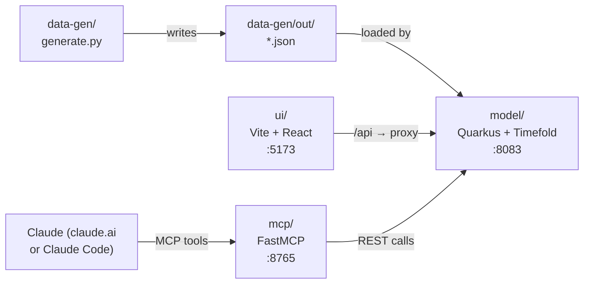

# Japanese Work-Life Balancer

A weekly scheduling tool that **prevents overwork** by treating employee health as a hard constraint, not
an afterthought. Built for Hack for Humanity London 2026-10-29.

Karoshi — death from overwork — is a documented crisis in Japan, and the same pattern is increasingly
visible in London's care and hospitality sectors and in Japanese firms' London offices. This tool gives
managers, HR staff and executives an AI-assisted plan for a full work week: it assigns tasks to employees
while enforcing daily/weekly hour limits, minimum rest, approved holidays and no-overlap rules. Every plan
is guaranteed to be feasible (zero hard-constraint violations). A health-first preset penalises consecutive
working days; a cost-first preset shows what the same week costs when health is deprioritised. The gap
between the two is the monetary value of protecting your staff.

---

## Architecture



| Service | Port | How to start |
|---|---|---|
| model (Quarkus + Timefold) | 8083 | `make model` |
| ui (Vite + React) | 5173 | `make ui` |
| mcp (FastMCP) | 8765 | `make mcp` |

---

## Prerequisites

| Tool | Minimum | Check |
|---|---|---|
| JDK | 21 | `java -version` |
| Maven | 3.9 | `mvn -version` |
| Node.js | 20 | `node -version` |
| Python | 3.11 | `python3 --version` |
| uv | any (optional) | `uv --version` |
| jq | any (optional, for curl one-liners) | `jq --version` |

**Timefold license** — the solver runs in evaluation mode without a license file.
If you have one, point to it via one of these (never commit the file):

```
export TIMEFOLD_LICENSE_PATH=/path/to/timefold-license.pem
# or
export TIMEFOLD_LICENSE=/path/to/timefold-license.pem
# or drop it at ~/timefold-license.pem
```

---

## Quick start

```bash
make setup   # checks tools, installs npm & Python deps
make demo    # generates data, starts model + ui + mcp; Ctrl-C stops all
```

Open **http://localhost:5173** in your browser.

---

## Run services one at a time

Run each in a separate terminal from the project root:

```bash
make data    # generate synthetic JSON scenarios → data-gen/out/
make model   # start Quarkus on :8083  (keep running)
make ui      # start Vite on :5173     (keep running)
make mcp     # start MCP server on :8765 (keep running)
make test    # run model unit tests (model must NOT be running with quarkus:dev)
make clean   # remove build outputs and data-gen/out/
```

---

## Using the app

### Dashboard walkthrough

1. **Pick a scenario** from the dropdown (top left) — e.g. `burnout`.
2. **Pick a preset** — `health-first` (default), `balanced` or `cost-first`.
3. Set a **time limit** (10 s for demos, 30 s for real runs) and click **Solve**.
4. Watch the **live score** update every 2 seconds in the status bar.
5. When solving finishes, read the **KPI cards**:
   - *Health group* (left): healthy share, at-risk count, average consecutive days, idle hours.
   - *Business group* (right): labor cost, revenue, profit, unassigned tasks.
6. Scan the **week grid**: each row is an employee, each column a day.
   Cell colours show the consecutive-day run position — green (1–2 days), amber (3), red (4+).
   Blue cells are approved holidays; hatched cells are public holidays.
   Click a row to see that employee's task list.
7. Check the **hours bar chart** against each employee's daily/weekly limits.
8. Read the **unassigned tasks table** to understand why tasks weren't covered (skill gap, capacity, holiday).
9. Inspect **broken constraints** — a healthy plan shows `0 hard`.
10. Click **Keep this run for comparison**, then re-solve with a different preset.
    The **compare panel** shows deltas: labor cost, profit, at-risk count, healthy share, idle hours, unassigned.
11. Switch **currency** (JPY / USD / GBP) via the top-bar selector (indicative fixed rates).
12. Switch **role** (Manager / HR / Executive) to reveal the longevity view (HR and Executive only).

### Use it from Claude

Register the MCP server (the model must be running):

```bash
claude mcp add --transport http jwlb http://localhost:8765/mcp
```

Available tools:

| Tool | What it does |
|---|---|
| `list_scenarios` | Lists available scenario names |
| `solve_schedule` | Solves a scenario with a preset; waits for the result |
| `get_plan_summary` | Score, company KPIs, top at-risk employees, unassigned count by reason |
| `get_employee_schedule` | One employee's tasks, hours, consecutive days, cost/profit |
| `explain_score` | Broken-constraints list |
| `compare_presets` | Solves the same scenario with multiple presets; returns a KPI comparison table |
| `stop_solving` | Stops a running solve and returns the current best plan |

Example prompts:

```
Compare cost-first and health-first for the burnout week and tell me
what health protection costs in GBP.
```

```
Solve the overloaded scenario with the health-first preset and explain
why each unassigned task couldn't be covered.
```

```
Show me the schedule for employee E-023 after solving the normal scenario.
```

---

## REST API quick reference

Base URL: `http://localhost:8083`

| Method | Path | Purpose |
|---|---|---|
| GET | `/demo-data` | List available scenario names |
| GET | `/demo-data/{name}` | Return scenario JSON (unsolved) |
| POST | `/schedules?preset=health-first&limitSeconds=30` | Submit a solve job; returns job id |
| POST | `/schedules/scenario/{name}?preset=…&limitSeconds=…` | Load scenario from disk and solve |
| GET | `/schedules` | List job ids |
| GET | `/schedules/{jobId}` | Full result: schedule, KPIs, broken constraints |
| GET | `/schedules/{jobId}/status` | Status and score only |
| DELETE | `/schedules/{jobId}` | Stop solving; return current best |
| PUT | `/schedules/analyze` | Return broken constraints for a supplied schedule |

**Example — solve the burnout scenario and read KPIs:**

```bash
JOB=$(curl -s -X POST \
  "localhost:8083/schedules/scenario/burnout?preset=health-first&limitSeconds=30")
sleep 32
curl -s "localhost:8083/schedules/$JOB" | jq '{score, kpis}'
```

---

## How it plans

### Constraints

**Hard** — a plan that breaks any of these is infeasible and will never be returned:

| Constraint | Rule | Penalty unit |
|---|---|---|
| Required skills | Employee lacks a skill the task needs | per missing skill |
| Availability | Task falls outside the employee's available window | minutes outside |
| Approved holiday | Task assigned on the employee's approved holiday | task minutes |
| Public holiday | Any task assigned on a company-wide holiday | task minutes |
| Task within shift | Task starts before 09:00 or ends after 17:00 | minutes outside |
| One task at a time | Two tasks for the same employee overlap | overlap minutes |
| Max hours per day | Total task minutes exceed the employee's daily limit | excess minutes |
| Max hours per week | Total task minutes exceed the employee's weekly limit | excess minutes |
| Minimum rest | Rest between consecutive shifts is less than the employee's minimum | missing rest hours |

**Medium** — maximised after hard constraints are satisfied:

| Constraint | Rule | Penalty unit |
|---|---|---|
| Unassigned task | Task has no employee | 1 per task |

**Soft** — optimised subject to hard and medium; weights change per preset:

| Constraint | Unit | `health-first` | `balanced` | `cost-first` |
|---|---|---|---|---|
| Idle hours | minutes | 1 | 1 | 3 |
| Labor cost | per ¥100 | 1 | 1 | 5 |
| Requested day off | per date (480 min) | 3 | 1 | 1 |
| Avoided hours | minutes | 2 | 1 | 1 |
| Consecutive days risk | `(run − 2) × 480` per run ≥ 3 days | **10** | 1 | 0 (report only) |

The `health-first` preset is the default. `cost-first` reproduces the original PRD's "report health, don't score it"
behaviour, which makes the health–cost trade-off visible side by side in the compare panel.

---

## Scenarios

| File | Week starts | Public holidays | Employees | Tasks | Load | Story |
|---|---|---|---|---|---|---|
| `tiny.json` | 2026-11-09 | none | 8 | 40 | ~60% | Debugging and unit tests |
| `normal.json` | 2026-11-09 | none | 50 | 500 | ~65% | A regular week — all tasks should be assigned |
| `overloaded.json` | 2026-11-09 | none | 50 | 500 | ~125% | More work than capacity → unassigned tasks with reasons; 0 hard |
| `holiday.json` | 2026-11-02 | 2026-11-03 (Culture Day) | 50 | 500 | ~75% | ~20 tasks fall on the public holiday; ~10% of staff have approved holidays |
| `burnout.json` | 2026-11-09 | none | 50 | 500 | ~85% | 60% of staff arrive with 2–5 consecutive days already worked — best preset-comparison scenario |

---

## What is mocked or simplified

These simplifications were deliberate choices for the hackathon build:

- **No persistence.** Solve jobs live in memory; restarting the model clears them.
- **No authentication.** The role selector (Manager / HR / Executive) is a UI widget only; there is no login or access control.
- **Fixed FX rates.** Currency conversion uses hardcoded rates (1 USD = 150 JPY, 1 GBP = 195 JPY), labelled "indicative" in the UI. <!-- VERIFY: confirm the exact rates used in ui/src/fx.ts -->
- **Invented retention figures.** Company retention data (`year1: 0.88, year3: 0.74, year5: 0.63`) is synthetic.
- **Shifts are derived, not planned.** The solver assigns tasks to employees; a "shift" is derived as any day on which an employee has at least one task. The PRD described shifts as separate planned entities.
- **KPIs computed post-solve.** Shadow variables from the PRD (idle hours, labor cost, etc.) are calculated in plain Java after solving, not as Timefold shadow variables.
- **Health added as a soft constraint.** The PRD listed consecutive-day health metrics as reporting only; this build adds `Consecutive days risk` as a soft constraint (weight 10 in `health-first`, 0 in `cost-first`).
- **Soft penalties normalised.** Minutes and ¥100 units are used so equal preset weights are comparable.

---

## Troubleshooting

**Port already in use**
```bash
lsof -ti :8083 | xargs kill   # model
lsof -ti :5173 | xargs kill   # ui
lsof -ti :8765 | xargs kill   # mcp
```

**Wrong Java or Maven version on PATH**
```bash
java -version   # must be 21+
mvn -version    # must be 3.9+
```
On macOS with multiple JDKs: `export JAVA_HOME=$(/usr/libexec/java_home -v 21)`.

**UI shows "Model not running"**
The model takes 10–20 seconds to start. Wait for the Quarkus `Started in …` log line before loading the UI.
Or run `make demo` which waits for the model to be ready before starting the other services.

**Solver finishes but still shows hard violations**
This should not happen in normal scenarios. If it does, increase the solve time:
```bash
curl -s -X POST "localhost:8083/schedules/scenario/normal?preset=health-first&limitSeconds=60"
```
The default is 30 seconds. The maximum accepted value is 60.

**MCP server can't reach the model**
Set the model URL before starting the MCP server:
```bash
export MODEL_URL=http://localhost:8083
make mcp
```

**`make setup` warns about no license file**
This is a warning, not a failure. The solver runs in evaluation mode. If you have a Timefold hackathon license,
set `TIMEFOLD_LICENSE_PATH` as described in [Prerequisites](#prerequisites).

---

## Credits and license

The model is derived from
[TimefoldAI/timefold-quickstarts](https://github.com/TimefoldAI/timefold-quickstarts) (Apache-2.0),
`use-cases/employee-scheduling` branch `stable`.

All employee names and company data in the scenarios are **synthetic and fictional**.
No real personal data, health records or company information is used anywhere.

Built at Hack for Humanity London 2026-10-29.
