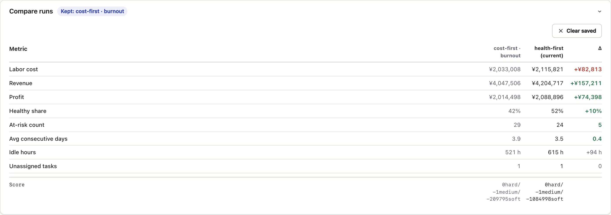
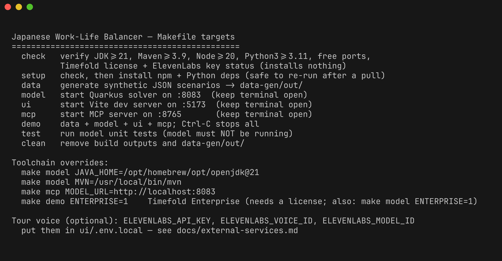
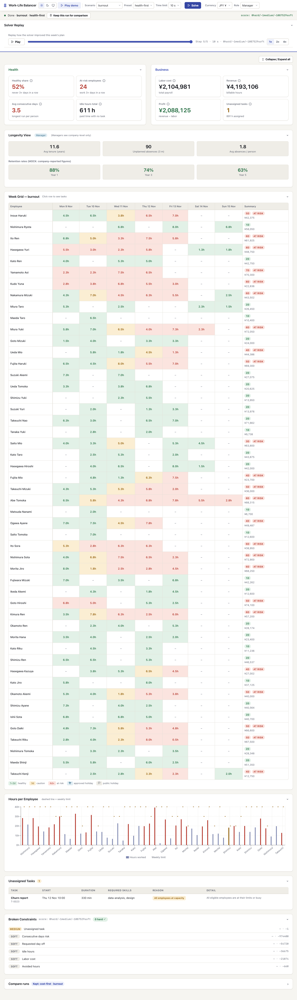
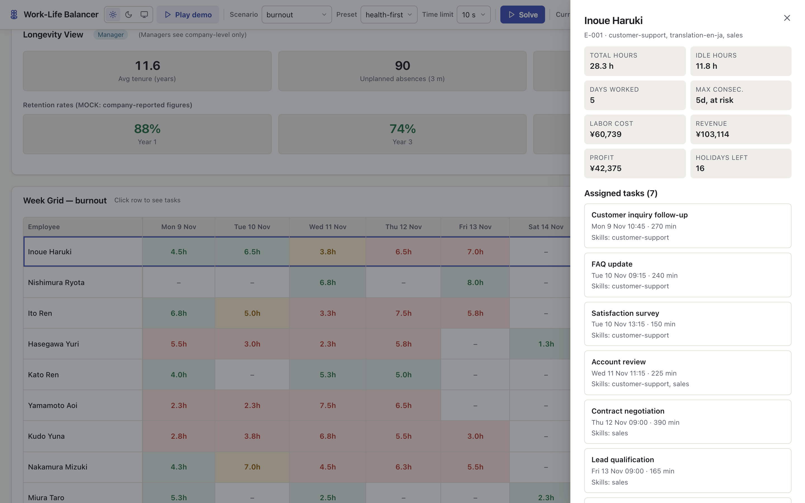
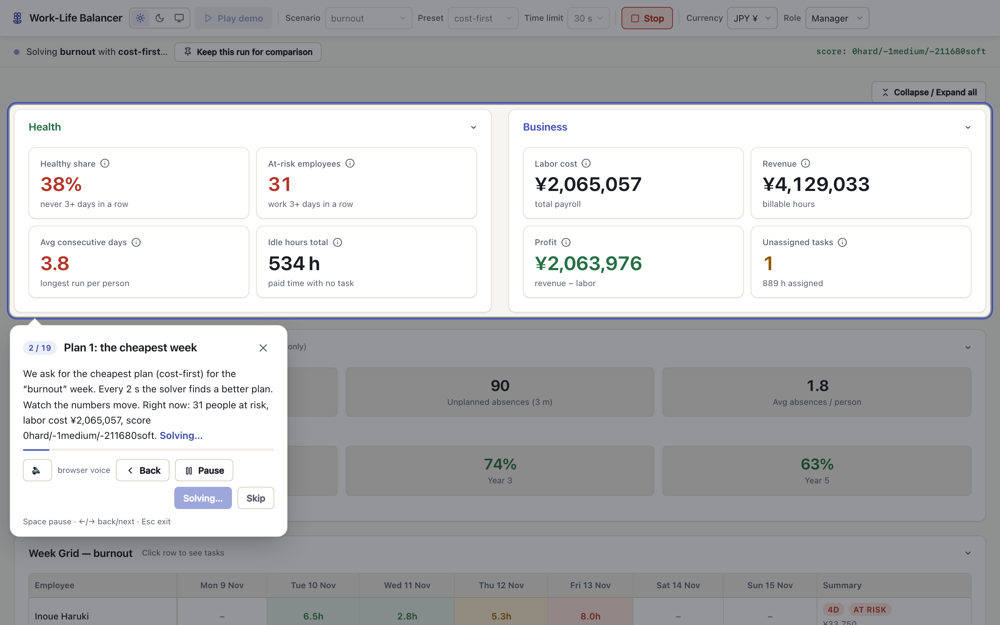
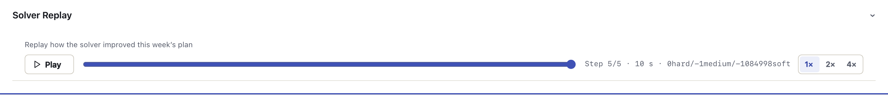
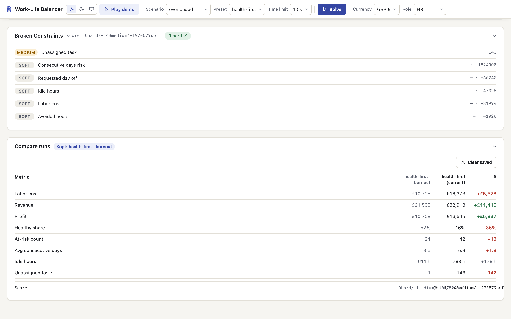
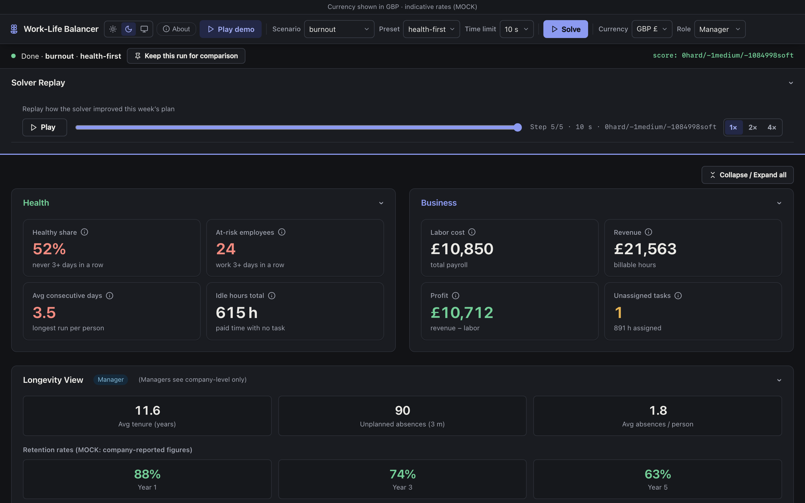
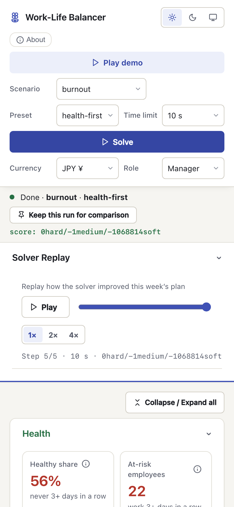
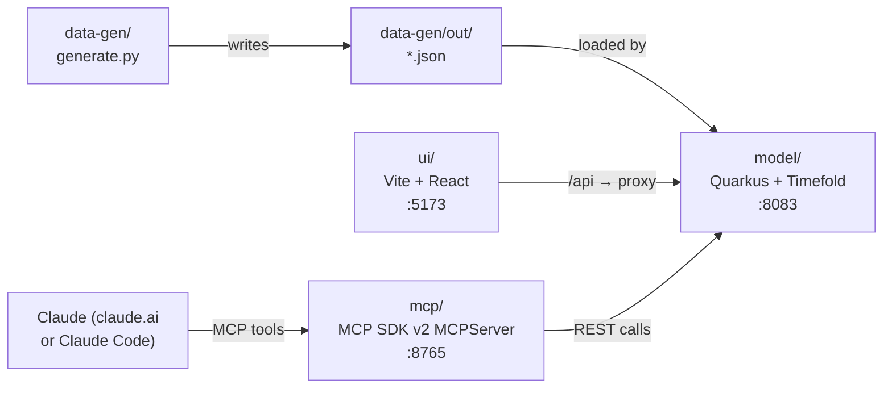

# Japanese Work-Life Balancer

A weekly scheduling tool that **prevents overwork** by treating employee health as a hard constraint, not
an afterthought. Built for Hack for Humanity London 2026-10-29.

Karoshi — death from overwork — is a documented crisis in Japan, and the same pattern is increasingly
visible in London's care and hospitality sectors and in Japanese firms' London offices. This tool gives
managers, HR staff and executives an AI-assisted plan for a full work week: it assigns tasks to employees
while enforcing daily/weekly hour limits, minimum rest, approved holidays and no-overlap rules. Every plan
is guaranteed to be feasible (zero hard-constraint violations). A health-first preset penalises consecutive
working days; a cost-first preset shows what the same week costs when health is deprioritised. The gap
between the two is the monetary value of protecting your staff.

<p align="center">
  <a href="docs/screenshots/02-dashboard/04-compare-runs.png">
    
  </a>
  <br>
  <sub>Same <code>burnout</code> week, two plans: <b>health-first</b> puts 10 fewer people at risk for ~¥59k more payroll.</sub>
</p>

## Contents

- [Quick start](#quick-start) · [Screenshots](#screenshots) · [Architecture](#architecture)
- **Setup:** [Prerequisites](#prerequisites) · [Run services one at a time](#run-services-one-at-a-time) ·
  [External services (ElevenLabs, Timefold)](docs/external-services.md) · [Maintaining](docs/maintaining.md)
- **Using the app:** [Guided tour](#guided-tour) · [Dashboard walkthrough](#dashboard-walkthrough) ·
  [Look and feel](#look-and-feel) · [Voice narration](#voice-narration-elevenlabs) · [Use it from Claude](#use-it-from-claude)
- **Reference:** [REST API](#rest-api-quick-reference) · [How it plans](#how-it-plans) · [Scenarios](#scenarios) ·
  [What is mocked or simplified](#what-is-mocked-or-simplified) · [Troubleshooting](#troubleshooting)
- [Credits and license](#credits-and-license)

> Most sections below are folded. Click a **▸** line to open it.

---

## Quick start

```bash
make setup   # checks tools, installs npm & Python deps
make demo    # generates data, starts model + ui + mcp; Ctrl-C stops all
```

Open **http://localhost:5173** in your browser, then click **▶ Play demo** for a hands-free narrated tour.

No accounts are needed: the solver runs on Timefold's free Community Edition and the tour uses your browser's
voice. For the premium ElevenLabs narrator or Timefold Enterprise, see [external services](docs/external-services.md).

---

## Screenshots

<table>
<tr>
  <td align="center" width="25%">
    <a href="docs/screenshots/01-cli/01-make-help.png">
      
    </a>
    <sub><b>CLI</b> — one <code>make</code> target per service</sub>
  </td>
  <td align="center" width="25%">
    <a href="docs/screenshots/02-dashboard/03-burnout-health-first.png">
      
    </a>
    <sub><b>Dashboard</b> — KPIs and week grid</sub>
  </td>
  <td align="center" width="25%">
    <a href="docs/screenshots/03-details/07-employee-panel.png">
      
    </a>
    <sub><b>Employee</b> — one person's week and risk</sub>
  </td>
  <td align="center" width="25%">
    <a href="docs/screenshots/05-tour/13-tour-step.png">
      
    </a>
    <sub><b>Guided tour</b> — narrated, solves live</sub>
  </td>
</tr>
<tr>
  <td align="center" width="25%">
    <a href="docs/screenshots/02-dashboard/05-solver-replay.png">
      
    </a>
    <sub><b>Replay</b> — how the solver improved</sub>
  </td>
  <td align="center" width="25%">
    <a href="docs/screenshots/03-details/09-overloaded-broken-constraints.png">
      
    </a>
    <sub><b>Overloaded week</b> — still 0 hard</sub>
  </td>
  <td align="center" width="25%">
    <a href="docs/screenshots/04-themes-and-mobile/10-dark-theme.png">
      
    </a>
    <sub><b>Dark theme</b> — money in GBP</sub>
  </td>
  <td align="center" width="25%">
    <a href="docs/screenshots/04-themes-and-mobile/11-mobile-390.png">
      
    </a>
    <sub><b>Phone</b> — 390 px wide</sub>
  </td>
</tr>
</table>

> Full gallery (15 shots, with captions) → [docs/screenshots/](docs/screenshots/README.md)

---

## Architecture



| Service | Port | How to start |
|---|---|---|
| model (Quarkus + Timefold) | 8083 | `make model` |
| ui (Vite + React) | 5173 | `make ui` |
| mcp (MCP SDK v2) | 8765 | `make mcp` |

---

## Prerequisites

<details>
<summary>JDK 21, Maven 3.9, Node 20, Python 3.11 — no accounts needed</summary>

| Tool | Minimum | Check | Install (macOS) |
|---|---|---|---|
| JDK | 21 | `java -version` | `brew install openjdk@21` or [Temurin](https://adoptium.net/) |
| Maven | 3.9 | `mvn -version` | `brew install maven` ([maven.apache.org](https://maven.apache.org/download.cgi)) |
| Node.js | 20 | `node --version` | [nvm](https://github.com/nvm-sh/nvm) or [nodejs.org](https://nodejs.org/) |
| Python | 3.11 | `python3 --version` | `brew install python@3.12` |
| uv | any (optional) | `uv --version` | [docs.astral.sh/uv](https://docs.astral.sh/uv/getting-started/installation/) |
| jq | any (optional, for curl one-liners) | `jq --version` | `brew install jq` |

`make setup` checks every version and stops with a fix if one is too old, including when an older Maven sits earlier
on your `PATH`. More toolchain traps are in [maintaining.md](docs/maintaining.md#toolchain-traps).

**Optional services** (each has a free option and a fallback, so the app runs without them):

- **ElevenLabs** — the premium narrator voice for the tour. Needs an API key in `ui/.env.local`.
- **Timefold Enterprise** — exact match counts in *Broken constraints*. Needs a license and `make demo ENTERPRISE=1`;
  a license has no effect on the default Community build.

Step-by-step account, key, voice and license setup, with links: **[docs/external-services.md](docs/external-services.md)**.

</details>

## Run services one at a time

<details>
<summary>One <code>make</code> target per service, each in its own terminal</summary>

Run each in a separate terminal from the project root:

```bash
make data    # generate synthetic JSON scenarios → data-gen/out/
make model   # start Quarkus on :8083  (keep running)
make ui      # start Vite on :5173     (keep running)
make mcp     # start MCP server on :8765 (keep running)
make test    # run model unit tests (model must NOT be running with quarkus:dev)
make clean   # remove build outputs and data-gen/out/
```

</details>

---

## Using the app

### Guided tour

Click **▶ Play demo** (top bar, next to the title) to run a hands-free 19-step story through the app.
The tour solves `burnout` (cost-first then health-first) and `overloaded` live with a 10-second time limit;
if the model is not reachable it falls back to recorded results automatically.
Keyboard: **Space** pause/resume, **← →** back/next, **Esc** exit.

### Dashboard walkthrough

<details>
<summary>16 steps: solve, read the KPIs and grid, compare presets, replay, theme, currency, role</summary>

1. **Pick a scenario** from the dropdown (top left) — e.g. `burnout`.
2. **Pick a preset** — `health-first` (default), `balanced` or `cost-first`.
3. Set a **time limit** (10 s for demos, 30 s for real runs) and click **Solve**.
4. Watch the **live score** update every 2 seconds in the status bar.
5. When solving finishes, read the **KPI cards**:
   - *Health group* (left): healthy share, at-risk count, average consecutive days, idle hours.
   - *Business group* (right): labor cost, revenue, profit, unassigned tasks.
6. Scan the **week grid**: each row is an employee, each column a day.
   Cell colours show the consecutive-day run position — green (1–2 days), amber (3), red (4+).
   Blue cells are approved holidays; hatched cells are public holidays.
   Click a row to see that employee's task list.
7. Check the **hours bar chart** against each employee's daily/weekly limits.
8. Read the **unassigned tasks table** to understand why tasks weren't covered (skill gap, capacity, holiday).
9. Inspect **broken constraints** — a healthy plan shows `0 hard`.
10. Click **Keep this run for comparison** (in the status line), then re-solve with a different preset.
    Open **Compare runs** at the bottom of the page (collapsed by default) to see deltas: labor cost,
    profit, at-risk count, healthy share, idle hours, unassigned.
11. Use the **Solver replay bar** (appears below the score line after solving) to replay how the solver
    improved the plan step by step. Hit **▶ Play** or scrub the slider. Speed buttons (1×, 2×, 4×)
    control playback pace; **Live** jumps back to the final result. Each step shows elapsed time and score.
12. Switch **theme** (Light / Dark / System) via the compact ☀/☾/🖥 toggle next to the title. Stored in localStorage.
13. Switch **currency** (JPY / USD / GBP) via the top-bar selector (fixed indicative rates: 1 USD = 150 JPY, 1 GBP = 195 JPY).
14. Switch **role** (Manager / HR / Executive). The **Longevity** panel sits under the KPI cards:
    Manager sees company-level numbers; HR and Executive also see per-employee tenure and absences.
15. Click **ⓘ** on any KPI card for a plain-language explanation of what it measures.
16. Every panel is **collapsible**: click its header to fold it away; the page remembers your choice.
    The guided tour opens a folded panel when it needs to point at it.

</details>

### Look and feel

<details>
<summary>Design tokens, contrast, icons and reduced motion</summary>

The design language lives in [`design-system/MASTER.md`](design-system/MASTER.md): colour tokens named by meaning
(`--ink`, `--surface`, `--accent`, `--signal-good/warn/bad`), a type and spacing scale, and motion timings, with every
text colour pair at 4.5:1 contrast or better in light and dark. [`ui/src/theme.css`](ui/src/theme.css) is loaded last
and only restyles existing classes, so visual changes never touch component markup. Icons are SVG
([Lucide](https://lucide.dev)); animations switch off when the system asks for reduced motion.

</details>

### Voice narration (ElevenLabs)

<details>
<summary>Optional premium voice for the tour — env vars, picking a voice, fallback</summary>

The **▶ Play demo** tour reads each step aloud and waits for the line to finish before it moves on.
Press **🔊/🔇** in the tour controls (or **M**) to mute. The app remembers your choice.

**Set-up in one minute.** Create an API key on the [ElevenLabs API keys page](https://elevenlabs.io/app/api/api-keys)
with the **Text to Speech** permission, then put it in `ui/.env.local` (git-ignored) and restart `make demo`:

```dotenv
ELEVENLABS_API_KEY=sk_your_key_here
```

Account creation, key permissions, choosing a voice from the [Voice Library](https://elevenlabs.io/app/voice-library),
quotas and error codes: **[docs/external-services.md → ElevenLabs](docs/external-services.md#elevenlabs-premium-tour-voice)**.

**Settings.** These belong to *this app*, not to ElevenLabs. The Vite dev server in `ui/tts-plugin.ts` reads them
from your shell first, then `ui/.env.local`, then `ui/.env`.

| Variable | Needed? | Default | What it does |
|---|---|---|---|
| `ELEVENLABS_API_KEY` | Required for the premium voice | — | Read on every request, so a new key works without a restart |
| `ELEVENLABS_VOICE_ID` | Optional | `pFZP5JQG7iQjIQuC4Bku` ("Lily", a warm British narrator) | Which voice reads the tour. **Read once at start-up — restart after changing it** |
| `ELEVENLABS_MODEL_ID` | Optional | `eleven_multilingual_v2` | Speech model (it says Japanese names well). Read once at start-up |

Check what the server is using: `curl -s localhost:5173/tts` prints the voice and model, and `.logs/ui.log` shows
`apiKey=present` or `MISSING`. Spoken lines are cached in `ui/.tts-cache/` (git-ignored), keyed by voice and text,
so fixed lines replay for free and switching voices never replays old audio.

**Without a working key.** If `/tts` fails or takes more than 4 s, your browser's own British voice
reads the tour, and the tour controls show a small "browser voice" note. The tour keeps running either way.

**The key never reaches the browser.** The browser posts text to `POST /tts` on the Vite server, and
only the server calls ElevenLabs. The key is not in the built bundle.

</details>

### Use it from Claude

<details>
<summary>Register the MCP server, 7 tools, example prompts</summary>

You need [Claude Code](https://docs.claude.com/en/docs/claude-code/overview) or another
[MCP](https://modelcontextprotocol.io/) client. Register the MCP server (the model must be running):

```bash
claude mcp add --transport http jwlb http://localhost:8765/mcp
```

Available tools:

| Tool | What it does |
|---|---|
| `list_scenarios` | Lists available scenario names |
| `solve_schedule` | Solves a scenario with a preset; waits for the result |
| `get_plan_summary` | Score, company KPIs, top at-risk employees, unassigned count by reason |
| `get_employee_schedule` | One employee's tasks, hours, consecutive days, cost/profit |
| `explain_score` | Broken-constraints list |
| `compare_presets` | Solves the same scenario with multiple presets; returns a KPI comparison table |
| `stop_solving` | Stops a running solve and returns the current best plan |

Example prompts:

```
Compare cost-first and health-first for the burnout week and tell me
what health protection costs in GBP.
```

```
Solve the overloaded scenario with the health-first preset and explain
why each unassigned task couldn't be covered.
```

```
Show me the schedule for employee E-023 after solving the normal scenario.
```

</details>

---

## REST API quick reference

<details>
<summary>Endpoints on <code>http://localhost:8083</code> and a curl example</summary>

Base URL: `http://localhost:8083`

| Method | Path | Purpose |
|---|---|---|
| GET | `/` | 303 redirect to the UI (`http://localhost:5173`; override with `app.ui-url`) |
| GET | `/demo-data` | List available scenario names |
| GET | `/demo-data/{name}` | Return scenario JSON (unsolved) |
| POST | `/schedules?preset=health-first&limitSeconds=30` | Submit a solve job (body = WorkSchedule JSON); returns job id. Missing body → 400 with a hint. |
| POST | `/schedules/scenario/{name}?preset=…&limitSeconds=…` | Load scenario from disk and solve |
| GET | `/schedules` | List job ids |
| GET | `/schedules/{jobId}` | Full result: schedule, KPIs, broken constraints |
| GET | `/schedules/{jobId}/status` | Status and score only |
| DELETE | `/schedules/{jobId}` | Stop solving; return current best |
| PUT | `/schedules/analyze` | Return broken constraints for a supplied schedule |

**Example — solve the burnout scenario and read KPIs:**

```bash
JOB=$(curl -s -X POST \
  "localhost:8083/schedules/scenario/burnout?preset=health-first&limitSeconds=30")
sleep 32
curl -s "localhost:8083/schedules/$JOB" | jq '{score, kpis}'
```

</details>

---

## How it plans

<details>
<summary>Hard, medium and soft constraints, and how each preset weighs them</summary>

### Constraints

**Hard** — a plan that breaks any of these is infeasible and will never be returned:

| Constraint | Rule | Penalty unit |
|---|---|---|
| Required skills | Employee lacks a skill the task needs | per missing skill |
| Availability | Task falls outside the employee's available window | minutes outside |
| Approved holiday | Task assigned on the employee's approved holiday | task minutes |
| Public holiday | Any task assigned on a company-wide holiday | task minutes |
| Task within shift | Task starts before 09:00 or ends after 17:00 | minutes outside |
| One task at a time | Two tasks for the same employee overlap | overlap minutes |
| Max hours per day | Total task minutes exceed the employee's daily limit | excess minutes |
| Max hours per week | Total task minutes exceed the employee's weekly limit | excess minutes |
| Minimum rest | Rest between consecutive shifts is less than the employee's minimum | missing rest hours |

**Medium** — maximised after hard constraints are satisfied:

| Constraint | Rule | Penalty unit |
|---|---|---|
| Unassigned task | Task has no employee | 1 per task |

**Soft** — optimised subject to hard and medium; weights change per preset:

| Constraint | Unit | `health-first` | `balanced` | `cost-first` |
|---|---|---|---|---|
| Idle hours | minutes | 1 | 1 | 3 |
| Labor cost | per ¥100 | 1 | 1 | 5 |
| Requested day off | per date (480 min) | 3 | 1 | 1 |
| Avoided hours | minutes | 2 | 1 | 1 |
| Consecutive days risk | `(run − 2) × 480` per run ≥ 3 days | **10** | 1 | 0 (report only) |

The `health-first` preset is the default. `cost-first` reproduces the original PRD's "report health, don't score it"
behaviour, which makes the health–cost trade-off visible side by side in the compare panel.

</details>

---

## Scenarios

<details>
<summary>Five synthetic weeks: <code>tiny</code>, <code>normal</code>, <code>overloaded</code>, <code>holiday</code>, <code>burnout</code></summary>

| File | Week starts | Public holidays | Employees | Tasks (approx.) | Load | Story |
|---|---|---|---|---|---|---|
| `tiny.json` | 2026-11-09 | none | 8 | 56 | ~60% | Debugging (the model's unit tests use their own hand-written copy) |
| `normal.json` | 2026-11-09 | none | 50 | ~250 | ~50% | A regular week — all tasks should be assigned |
| `overloaded.json` | 2026-11-09 | none | 50 | ~650 | ~125% | More work than capacity → unassigned tasks with reasons; 0 hard |
| `holiday.json` | 2026-11-02 | 2026-11-03 (Culture Day) | 50 | ~430 | ~80% | ~20 tasks fall on the public holiday; ~10% of staff have approved holidays |
| `burnout.json` | 2026-11-09 | none | 50 | ~275 | ~55% | ~30% of staff arrive with 2–5 consecutive days already worked — best preset-comparison scenario |

Task counts are tuned to hit the target load ratios, not fixed at a round number.
The `burnout` scenario is calibrated so that `health-first` and `cost-first` produce visibly different
at-risk counts without leaving too many tasks unassigned under either preset.

</details>

---

## What is mocked or simplified

<details>
<summary>Deliberate hackathon shortcuts: no persistence, no auth, fixed FX, derived shifts, and more</summary>

These simplifications were deliberate choices for the hackathon build:

- **No persistence.** Solve jobs live in memory; restarting the model clears them.
- **No authentication.** The role selector (Manager / HR / Executive) is a UI widget only; there is no login or access control.
- **Fixed FX rates.** Currency conversion uses hardcoded rates (1 USD = 150 JPY, 1 GBP = 195 JPY), labelled "indicative" in the UI.
- **Invented retention figures.** Company retention data (`year1: 0.88, year3: 0.74, year5: 0.63`) is synthetic.
- **Shifts are derived, not planned.** The solver assigns tasks to employees; a "shift" is derived as any day on which an employee has at least one task. The PRD described shifts as separate planned entities.
- **KPIs computed post-solve.** Shadow variables from the PRD (idle hours, labor cost, etc.) are calculated in plain Java after solving, not as Timefold shadow variables.
- **Health added as a soft constraint.** The PRD listed consecutive-day health metrics as reporting only; this build adds `Consecutive days risk` as a soft constraint (weight 10 in `health-first`, 0 in `cost-first`). The constraint also adds a one-off per-person charge for employees whose run reaches 3+ days, which directly reduces the at-risk headcount KPI — the exact charge value is documented in [model/README.md](model/README.md).
- **Soft penalties normalised.** Minutes and ¥100 units are used so equal preset weights are comparable.
- **Broken-constraints `matchCount` shows "–".** Timefold Solver 2.7 Community edition's score analysis does not return per-match counts; the UI falls back to showing "–" for that column. Enterprise edition would show exact counts.
- **Scenarios retuned for demonstrability.** The original spec called for 65% load in `normal` and 85% load / 60% carry-in in `burnout`. At those numbers, `burnout` had a provable floor of ~39 at-risk employees regardless of preset (Monday alone needed 46 concurrent staff but only 14 could safely work consecutive days), so `health-first` and `cost-first` would have looked identical. The generator was retuned: ordinary staff carry in 0–1 days (was 0–2); `normal` targets ~50% load; `burnout` targets ~55% load with ~30% of staff carrying in 2–5 days. Approximate achieved ratios are printed by the generator at runtime.

</details>

---

## Troubleshooting

<details>
<summary>Wrong Java or Maven version on PATH</summary>

```bash
java -version   # must show 21+
mvn -version    # must show 3.9+
```
On macOS with multiple JDKs, point Maven at Java 21:
```bash
export JAVA_HOME=$(/usr/libexec/java_home -v 21)
make model   # or: make model JAVA_HOME=$(/usr/libexec/java_home -v 21)
```
`java_home` only sees JDKs in `/Library/Java/JavaVirtualMachines`. A JDK that IntelliJ downloaded lives in `~/.jdks/`;
pass it directly: `make model JAVA_HOME=$HOME/.jdks/<jdk-21-folder>/Contents/Home`.

If `make setup` says Maven is too old, an older `mvn` is probably earlier on your `PATH` (it lists them). Use the
newer one:
```bash
make setup MVN=/opt/homebrew/bin/mvn
make demo  MVN=/opt/homebrew/bin/mvn    # same for make model / make test
```

</details>

<details>
<summary>Port already in use</summary>

```bash
lsof -ti :8083 | xargs kill   # model
lsof -ti :5173 | xargs kill   # ui
lsof -ti :8765 | xargs kill   # mcp
```

If an old `make demo` is still holding `:5173`, Vite starts the new UI on the next free port (e.g. `:5174`) and
the old tab keeps showing "Model not running". Check `.logs/ui.log` for the `Local:` URL, or stop the old process.

</details>

<details>
<summary>UI shows "Model not running"</summary>

The model takes 10–20 seconds to start. Wait for the Quarkus `Started in …` log line before loading the UI.
`make demo` waits automatically — it polls `localhost:8083/demo-data` before starting the other services.

</details>

<details>
<summary>MCP server can't reach the model</summary>

Set `MODEL_URL` before starting the MCP server:
```bash
export MODEL_URL=http://localhost:8083
make mcp
```

</details>

<details>
<summary><code>make setup</code> says no Timefold license was found</summary>

That's fine: the default Community edition needs no license, and a license has no effect on it. A license only
matters for the Enterprise build (`make demo ENTERPRISE=1`), which fills in the match counts under
*Broken constraints*. Where to get one and where to put it:
[docs/external-services.md → Timefold](docs/external-services.md#timefold-solver-community-or-enterprise).

</details>

<details>
<summary>The tour uses the browser voice, or the wrong ElevenLabs voice</summary>

Check `.logs/ui.log` for `apiKey=present` and run `curl -s localhost:5173/tts` to see the active voice. After changing
`ELEVENLABS_VOICE_ID`, restart `make demo`, and make sure an `export` in your shell isn't overriding `ui/.env.local`.
Error codes and fixes: [ElevenLabs troubleshooting](docs/external-services.md#troubleshooting-elevenlabs).

</details>

<details>
<summary>Solver finishes but still shows hard violations</summary>

This should not happen in normal scenarios. If it does, increase the solve time:
```bash
curl -s -X POST "localhost:8083/schedules/scenario/normal?preset=health-first&limitSeconds=60"
```
The default is 30 seconds; the maximum accepted value is 60.

</details>

---

## Credits and license

Built at Hack for Humanity London 2026-10-29 by Mani Sarkar ([@neomatrix369](https://github.com/neomatrix369))
in collaboration with Risako ([@inforisako](https://github.com/inforisako)).

**The idea came from Risako.** She was instrumental in framing the problem: work-life balance in Japan, how
long hours and long runs of working days harm people's health, and how at the extreme they lead to
**karoshi** (過労死, "death from overwork"). Her synopsis became the brief for this build:

> Managers, HR staff and executives in Japanese companies want an AI-assisted weekly plan that prevents
> overwork. Employee health and safety come before labor cost and profit: the company accepts lower profit
> for a healthier workforce, and health and profit are reported side by side so the trade-off stays visible.
> The long-term aim is longevity — people stay for many years instead of falling ill, coming in less often
> or retiring early.

The product material behind the build lives in [`docs/plan/`](docs/plan/):

| Document | What it holds |
|---|---|
| [`work-scheduling-prd.md`](docs/plan/work-scheduling-prd.md) | The PRD: problem summary, planning entities, constraints, KPIs and users |
| [`clarifying-questions.md`](docs/plan/clarifying-questions.md) | Open questions about the PRD and the answers we settled on |
| [`claude-code-prompt.md`](docs/plan/claude-code-prompt.md) | The build spec, including the deliberate simplifications (it wins where it differs from the PRD) |
| [`kickoff-prompt.md`](docs/plan/kickoff-prompt.md) | The phase-by-phase build plan with checkpoints |

The model is derived from
[TimefoldAI/timefold-quickstarts](https://github.com/TimefoldAI/timefold-quickstarts) (Apache-2.0),
`use-cases/employee-scheduling` branch `stable`.

The MCP server uses the official [MCP Python SDK](https://github.com/modelcontextprotocol/python-sdk)
v2 `MCPServer` API (successor of the deprecated `FastMCP` class).

All employee names and company data in the scenarios are **synthetic and fictional**.
No real personal data, health records or company information is used anywhere.
