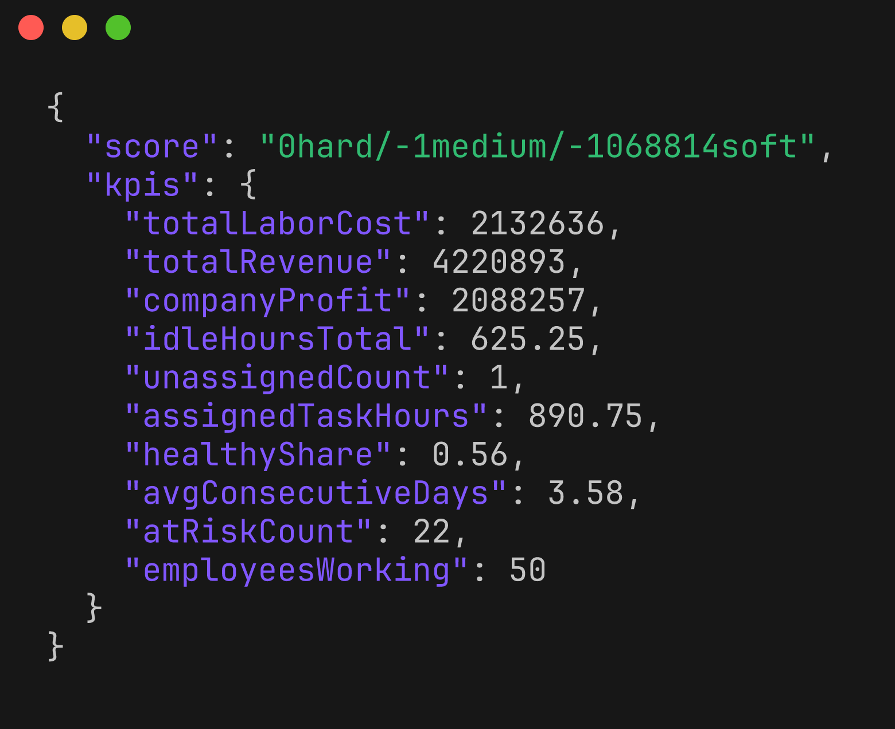
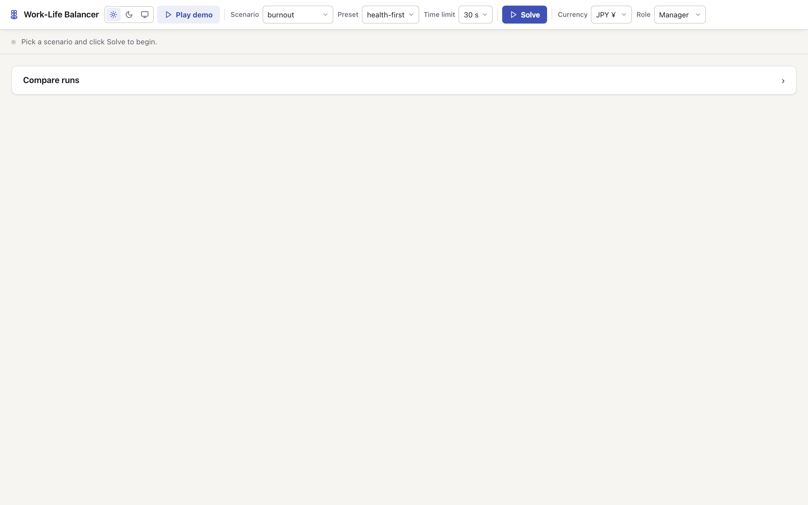
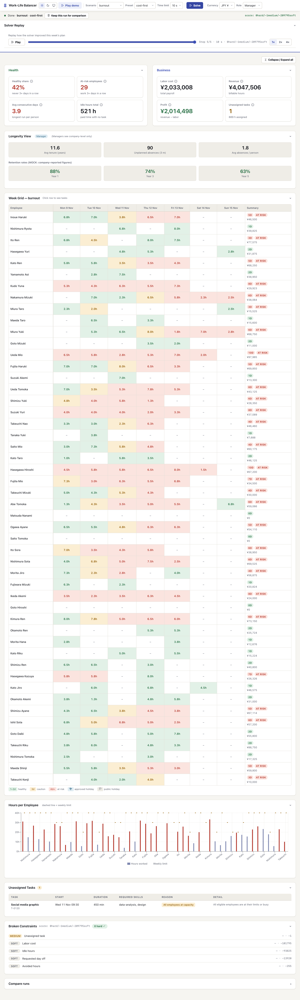
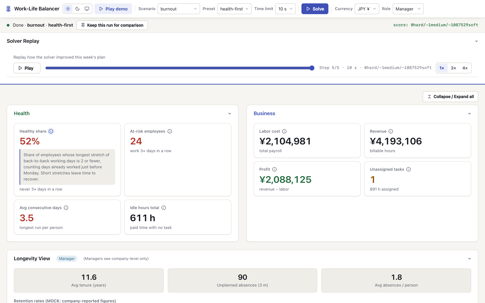
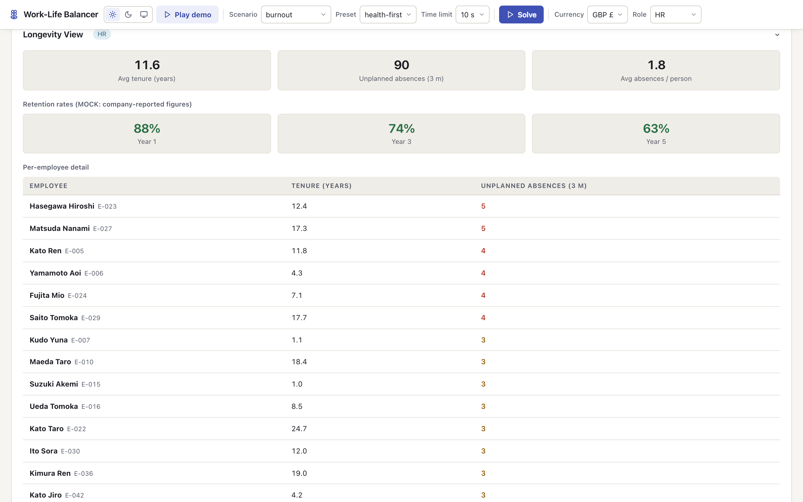
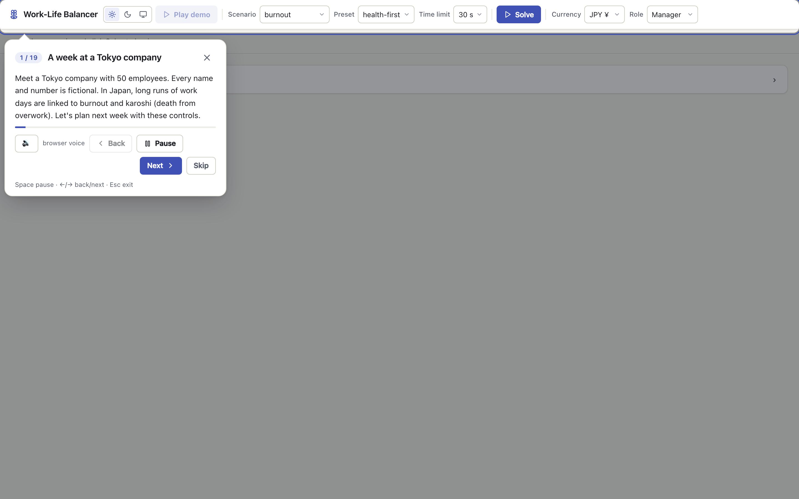

# Work-Life Balancer screenshot gallery

Real captures from a running `make demo` (model + UI + MCP), solving the synthetic scenarios with a 10-second
time limit. Numbers come from live solver runs, so a fresh run may differ slightly.

[← Back to the main README](../../README.md)

## 1. CLI and REST

Everything starts from one `make` target; the solver can also be driven directly over REST.

### `make help` — every service has one target

### Solve `burnout` with `health-first` over REST and read the KPIs

---

## 2. Dashboard

The main flow: pick a scenario and preset, solve, then compare the cheap plan with the healthy plan.

### Landing — pick a scenario and click Solve

### `burnout` week, `cost-first` — the cheapest plan

### `burnout` week, `health-first` — the same week, protecting people

### Compare runs — what health protection costs

### Solver replay — how the plan improved step by step

---

## 3. Details

Drill-downs: what each number means, one person's week, longevity data and an over-capacity week.

### KPI explainer — plain-language meaning of each card

### Employee panel — one person's tasks, hours and risk

### Longevity view as HR, in GBP

### `overloaded` week — broken constraints, still 0 hard

---

## 4. Themes and mobile

### Dark theme

### Phone width (390 px)

---

## 5. Guided tour

The **▶ Play demo** button runs a hands-free, narrated 19-step story.

### Tour start

### Tour step — "Plan 1: the cheapest week", solving live

---

### How these were made

UI shots: headless Chromium via Python Playwright at 1440×900 (and 390×844), device scale 2, with
`speechSynthesis` stubbed and `/tts` blocked so nothing plays aloud. CLI shots: real command output rendered
with [`freeze`](https://github.com/charmbracelet/freeze).
